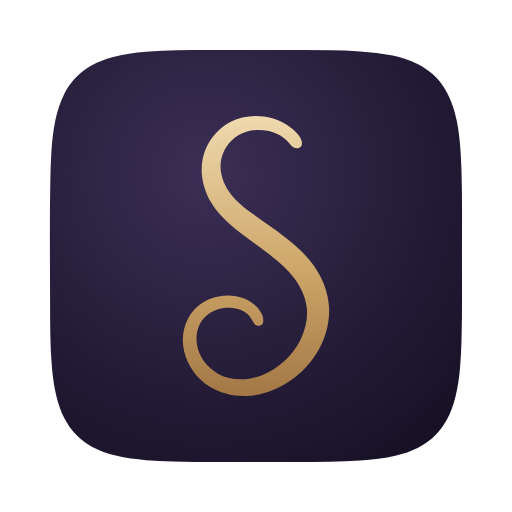

<p align="center">
  
</p>

<h1 align="center">Sympoie</h1>

<p align="center">An open-source, agent-native digital audio workstation, built from scratch in Rust.</p>

> **Before you try Sympoie, please read [Why I built Sympoie](#why-i-built-sympoie). It explains where I stand on AI and creative work, and why the agent here is a collaborator rather than a generator. If you'd rather not use the agent at all, you don't have to: every agent feature is optional and stays out of your way.**

## About

Sympoie is a free and open-source digital audio workstation (DAW) for people who make music: artists, producers and audio engineers. It's built around a fast, focused workflow. You arrange clips on a timeline, write parts in the piano roll, shape sound with devices, mix, automate and record, and nothing gets between you and the music while you do it.

Sympoie is also **agent-native**. A project is a folder of plain, readable files, and Sympoie can work side by side with an AI coding agent such as Claude Code or Codex. When you turn on agent mode, Sympoie saves the project as you work. It loads the agent's edits back in as a single step you can undo. It also gives the agent tools to see what you've selected, check its own edits, measure the audio it can't hear, and start or stop playback so you can listen. The agent works on your project. It doesn't replace you as the one making it.

The agent part is optional. Sympoie is designed to be a complete, comfortable DAW on its own, and you never have to turn agent mode on.

## Install a release

Prebuilt versions are published on the [Releases page](https://github.com/ForestWarbler/Sympoie/releases).

1. Open the latest release and download the file for your system (macOS, Windows or Linux).
2. Open Sympoie. You can also pass a project or audio files on the command line:

   ```sh
   sympoie MySong.symp
   sympoie drums.wav bass.wav
   ```

### Using it with an agent

1. Save your project. Agent mode works on a saved `.symp` project folder.
2. Turn on the **AGENT** switch in the status bar.
3. Open your agent (Claude Code, Codex or any other MCP-capable agent) in the project folder.

Sympoie writes `AGENTS.md`, `CLAUDE.md`, `.mcp.json` and `.codex/config.toml` into the folder. These files explain the project format to the agent and connect it to Sympoie's tools. Every change the agent makes shows up in Sympoie as one **Agent Edit**, which you can undo with ⌘Z (Ctrl+Z on Windows and Linux).

## Build from source

### Requirements

- **Rust 1.99 or newer**, installed with [rustup](https://rustup.rs)
- **A C++ compiler**, for the bundled pitch-shifting libraries:
  - macOS: Xcode Command Line Tools (`xcode-select --install`)
  - Windows: Visual Studio Build Tools with the "Desktop development with C++" workload
  - Linux: `build-essential` or your distribution's equivalent
- **Linux only:** audio and windowing development packages. On Debian or Ubuntu:

  ```sh
  sudo apt-get install libasound2-dev libxkbcommon-dev libwayland-dev libxcb1-dev
  ```

### Build and run

```sh
git clone https://github.com/ForestWarbler/Sympoie.git
cd Sympoie
cargo run --release
```

The optimized binary is written to `target/release/sympoie` (`sympoie.exe` on Windows).

Always judge performance with `--release`. A plain `cargo run` makes a debug build, which is slower to draw. The engine and dependencies are optimized even in debug builds, so a debug build is still fine for day-to-day development.

### Develop

```sh
cargo test --workspace                                 # run the test suite
cargo clippy --workspace --all-targets -- -D warnings  # lint, as CI does
cargo fmt --all                                        # format
```

Useful environment variables:

| Variable | Effect |
| --- | --- |
| `SYMPOIE_NO_AUDIO=1` | Start without opening an audio device (also used by the tests) |
| `SYMPOIE_RENDERER=glow` | Draw with OpenGL instead of wgpu (needs `--features glow`) |

The workspace has two crates: `crates/sympoie` is the audio engine, project model and file formats, and `crates/sympoie-app` is the application and its interface.

## Why I built Sympoie

I started Sympoie because I wanted an open-source DAW that anyone could use, and one that fit my own way of working. Much of its design simply follows my own taste.

I'm not a professional artist or audio engineer. I'm someone who loves music and spends his spare time making it. Sometimes music is the only way I have to say what I feel and think.

I don't want AI to take that away from us. It feels awful to imagine a machine generating music, film and other art in our place. At the same time, most AI music tools today don't fit into a real production workflow. They don't help with the creative process. They just produce more slop.

So I built Sympoie as an agent-native DAW, with the agent as a collaborator inside the workflow rather than a generator that makes the music for you. You stay the artist. The agent helps with the work around your ideas, and every change it makes is visible and can be undone.

Whether we like it or not, I don't think AI is going to stop advancing. I would rather understand what it can do and learn to work with it early, on our own terms. I hope more people will actively look for a way out of the slop, instead of covering their eyes and pretending AI isn't there, or rejecting it without thinking it through.

## License

Sympoie is licensed under GPL-3.0-or-later. See [LICENSE](LICENSE) and [THIRD_PARTY_LICENSES.md](THIRD_PARTY_LICENSES.md).
